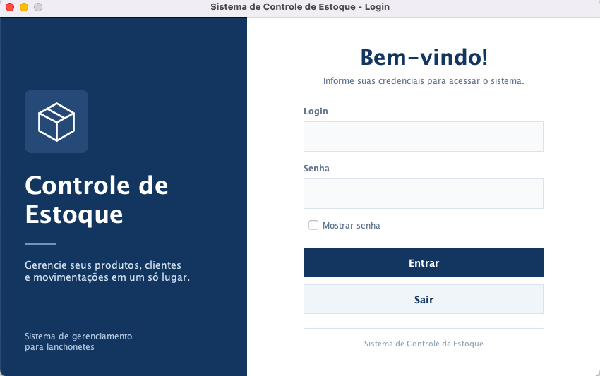
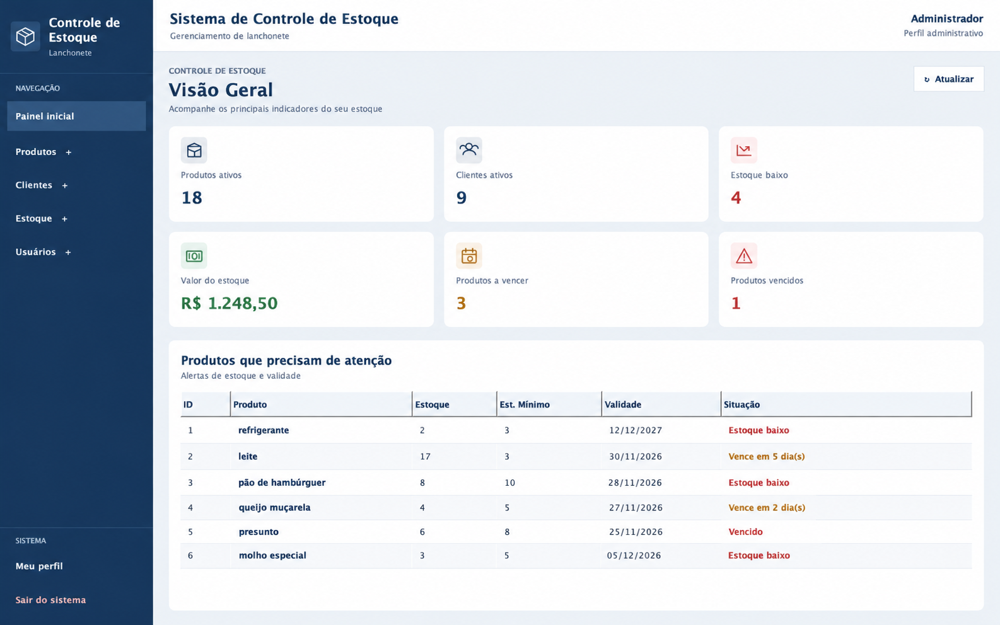
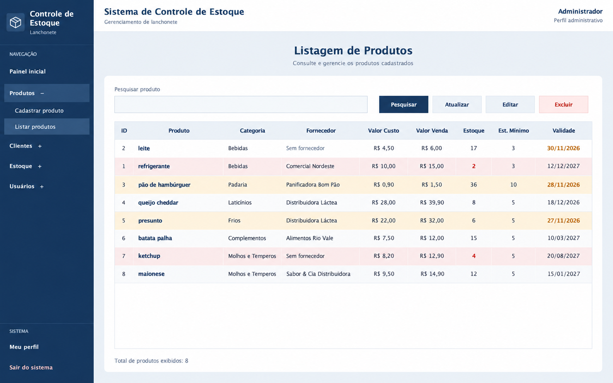
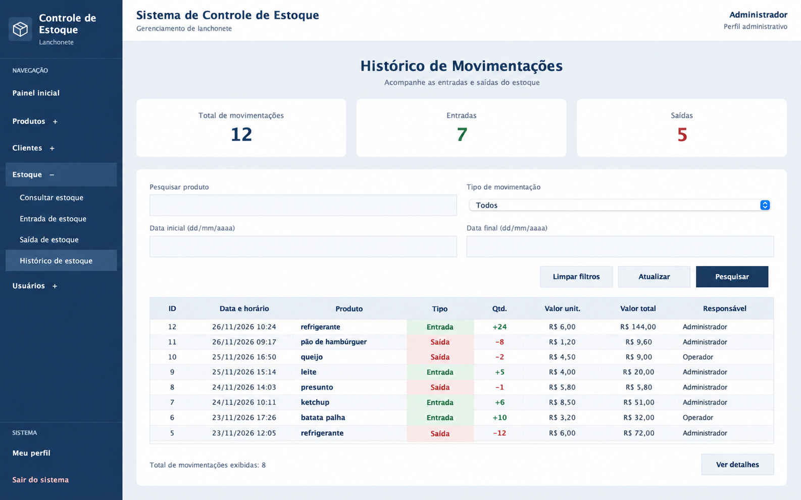
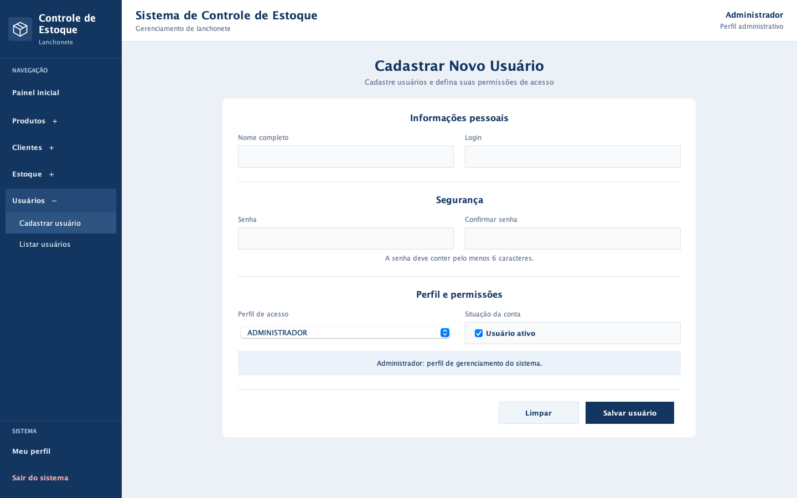

# controledeestoquev1.0

# Sistema de Controle de Estoque

## Sobre o projeto

Sistema desktop desenvolvido para auxiliar no gerenciamento
de estoque de uma lanchonete, proporcionando maior organização
dos produtos, controle de mercadorias e acompanhamento das
movimentações de estoque.

Projeto acadêmico desenvolvido durante o curso de Programador
de Sistemas do Senac-CE – Fortaleza – Centro.

## Tecnologias utilizadas

- Java
- Java Swing
- MySQL
- JDBC
- SQL
- Eclipse IDE
- Git e GitHub

## Principais funcionalidades

- Autenticação de usuários.
- Controle de permissões por perfil (Administrador e Operador).
- Dashboard com indicadores gerenciais.
- Cadastro, consulta e edição de produtos.
- Gerenciamento de clientes e usuários.
- Controle de entradas e saídas de estoque.
- Alertas de estoque baixo.
- Alertas de produtos próximos do vencimento.
- Histórico de movimentações com identificação do responsável.
- Pesquisa e filtros de movimentações.
- Validação de estoque disponível.

## Segurança e organização

- Hash SHA-256 para senhas dos usuários.
- Variável de ambiente para a senha do MySQL.
- Controle de acesso baseado em perfis.
- Transações no banco de dados.
- Separação do código em pacotes Model, View e DAO.

## Objetivo

Aplicar na prática os conhecimentos de programação orientada
a objetos, desenvolvimento de interfaces gráficas, banco de
dados e regras de negócio.

## Informações acadêmicas

- Instituição: Senac-CE – Fortaleza – Centro
- Curso: Programador de Sistemas
- Professor: Eugênio
- Ano: 2026
- Desenvolvimento: projeto acadêmico em equipe

## Demonstração do sistema

Imagens ilustrativas da aplicação, incluindo telas editadas
com dados fictícios para fins de demonstração.

### Tela de login

### Dashboard

### Listagem de produtos

### Entrada de estoque

### Histórico de movimentações

### Cadastro de usuários

